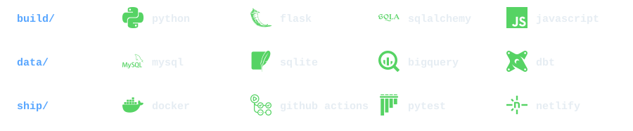

<h3 align="center">Basel Nasser</h3>

<code>Product Management</code> &nbsp; <code>IT Consulting</code> &nbsp; <code>Data Analysis</code>

---

<h3 align="center">Featured Project</h3>

<a href="https://github.com/baselnasser99/Data-Tagging-Application"><b>Data-Tagging-Application</b></a> 
My thesis: a web app that splits data-labelling work fairly across a team, even as people join or leave.

---

<h3 align="center">Connect With Me</h3>

---

<h3 align="center">Tech Stack & Tools</h3>

---

<h3 align="center">Contribution Activity</h3>

