<picture><source media="(prefers-color-scheme: dark)" srcset="https://github.com/baselnasser99/baselnasser99/raw/main/assets/profile.svg"></picture>

<h3 align="center">Basel Nasser</h3>

<code>Product Management</code> &nbsp; <code>IT Consulting</code> &nbsp; <code>Data Analysis</code>

I turn messy team and business problems into software people use. 
Starting my MS in Information Systems at Northeastern, Vancouver, in 2027.

---

<h3 align="center">Projects</h3>

<a href="https://github.com/baselnasser99/Data-Tagging-Application"><picture><source media="(prefers-color-scheme: dark)" srcset="https://github.com/baselnasser99/baselnasser99/raw/main/assets/thesis-banner.svg"></picture></a>
 Featured: <a href="https://github.com/baselnasser99/Data-Tagging-Application"><b>Data-Tagging-Application</b></a>, my bachelor's thesis

<a href="https://github.com/baselnasser99/Datathon-Project"><picture><source media="(prefers-color-scheme: dark)" srcset="https://github.com/baselnasser99/baselnasser99/raw/main/assets/project-vanscene.svg"></picture></a>
<a href="https://github.com/baselnasser99/second-order"><picture><source media="(prefers-color-scheme: dark)" srcset="https://github.com/baselnasser99/baselnasser99/raw/main/assets/project-second-order.svg"></picture></a>

---

<h3 align="center">Connect With Me</h3>

---

<h3 align="center">Tech Stack & Tools</h3>

<picture>
<source media="(prefers-color-scheme: dark)" srcset="https://github.com/baselnasser99/baselnasser99/raw/main/assets/tech-stack.svg">

</picture>

---

<h3 align="center">Contribution Activity</h3>

<picture>
<source media="(prefers-color-scheme: dark)" srcset="https://raw.githubusercontent.com/baselnasser99/baselnasser99/pacman-output/pacman-contribution-graph-dark.svg">

</picture>

